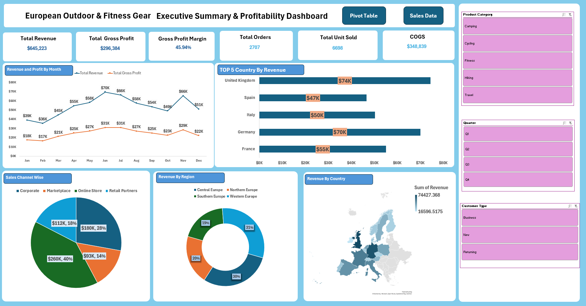

# Executive Sales & Profitability Dashboard (Excel)

An Excel dashboard that shows sales and profit for a European outdoor and fitness gear business in 2026.

## About the data

Practice dataset provided by my course institute (ED Tech Learning) as part of my Data Analytics course. It is sample data, not from a real company.

- 2,707 orders from January to December 2026
- 17 countries, 5 product categories, 4 sales channels

## Main numbers

| Measure | Value |
|---|---|
| Total Revenue | $645,223 |
| Gross Profit | $296,384 |
| Profit Margin | 45.94% |
| Total Orders | 2,707 |

## What I found

1. Western Europe sells the most, about 31% of all revenue.
2. Camping earns the most revenue but has the lowest margin (42.8%).
3. Corporate sales have the lowest margin (42.1%).
4. June is the best month and February is the weakest.
5. Business customers have the lowest margin (44.2%).

## What is in the dashboard

- KPI cards for revenue, profit, margin, orders, units and cost
- Charts for monthly sales, sales channels, regions and top countries
- Slicers to filter by product category, quarter and customer type

## Tools used

Microsoft Excel: Tables, PivotTables, pivot charts, slicers and formulas.

## Files

- `Executive_Sales_Profitability_Dashboard.xlsx` is the workbook
- `dashboard.png` is a screenshot of the dashboard

Open the workbook in desktop Excel and click the slicers to explore.

## Author

Anuj Jha
